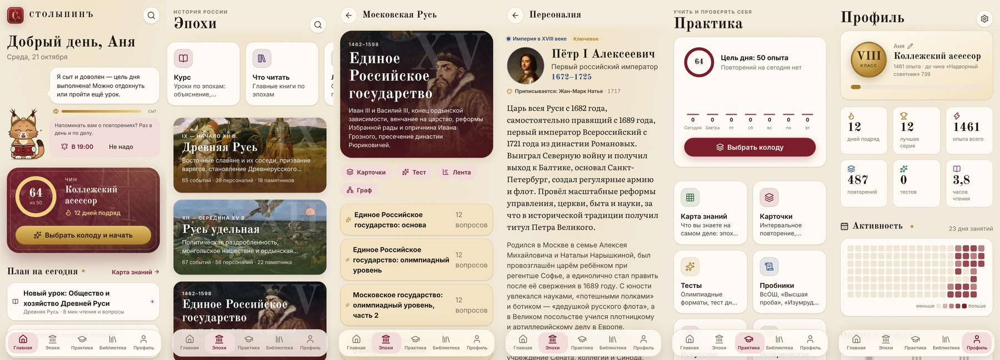
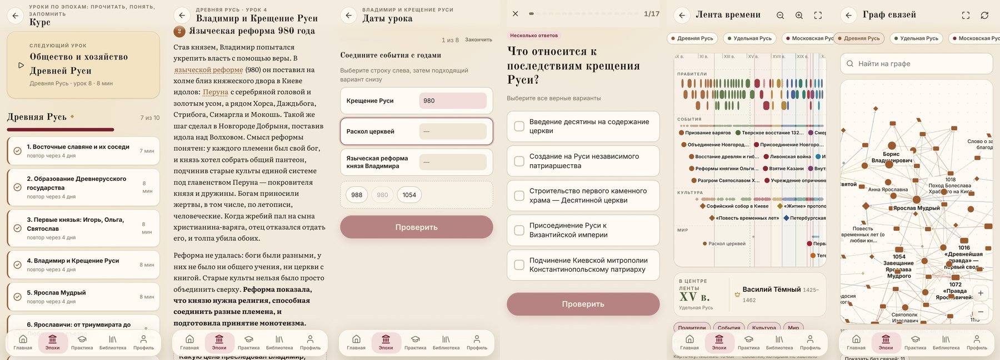
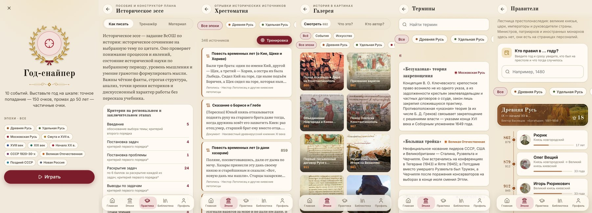
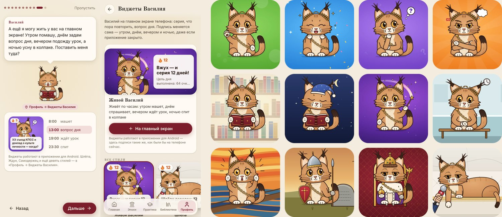
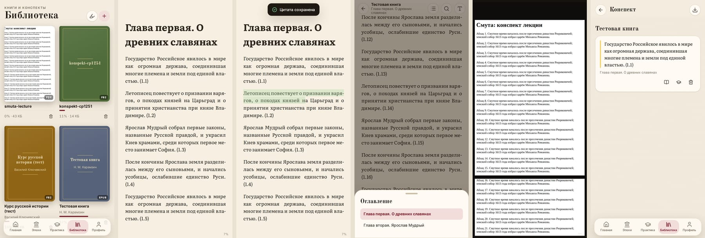

# СТОЛЫПИНЪ — ИСТОРИЯ

Приложение для Android, чтобы готовиться к олимпиадам по истории России: ВсОШ, «Высшая проба», «Изумруд»
и другие перечневые олимпиады. Работает без интернета: вся база знаний внутри приложения, прогресс хранится
только на телефоне.

Новости, вопросы и сообщения об ошибках — в чате в Telegram: [**@stolypinapp**](https://t.me/stolypinapp).



## Установка

1. Скачайте `.apk` последней версии из раздела [**Releases**](https://github.com/username777228555/stolypin/releases/latest).
2. Откройте файл на телефоне. Android попросит разрешить установку из этого источника.
3. Новые версии ставятся поверх старых, прогресс сохраняется. Приложение само подскажет, когда выйдет
   обновление (проверку можно выключить в настройках).

## Что внутри

- **Курс** — 135 уроков от Древней Руси до 2020-х годов. Урок можно прочитать, ответить на вопросы по ходу
  чтения, пересказать по памяти со сверкой по пунктам и выучить даты. Через 2, 7 и 21 день курс напомнит
  повторить урок.
- **Эпохи** — 11 периодов: больше 940 событий, почти 870 персоналий, больше 400 памятников культуры, 500 терминов
  и связи между ними. Есть лестница правителей, хрестоматия (почти 400 отрывков из источников) и галерея картин.
- **Лента времени и граф связей** — синхронная шкала правлений, событий и культуры. Граф показывает причины
  и следствия, участников, союзников и противников.
- **Карточки** — интервальное повторение по алгоритму FSRS, как в Anki. Есть режимы «Заучивание», «Письмо»
  и «Подбор», можно завести свои колоды или импортировать их из Quizlet и Anki.
- **Тесты и пробники** — олимпиадные форматы: хронология, соответствие, точная дата, «найди ошибки в тексте»,
  атрибуция картин. Пробные варианты прошлых олимпиад, «Тест дня» и режим экзамена. «Карта знаний» показывает,
  где пробелы, а «План на сегодня» подсказывает, с чего начать.
- **Историческое эссе** — как писать, критерии оценки, тренажёр и конструктор плана.
- **Игры** — «Хронология», «Год-снайпер», «Кто я?», «При ком это было?» и «Развилки»: решите за Минина, Петра I
  или Столыпина, а Василий расскажет, что могло бы выйти, и как было на самом деле.
- **Помощь Василия (ИИ)** — проверка пересказа урока, «Почему я ошибся?» в тестах, «Развилки» и вопросы к Василию
  на карточках. Работает по своему ключу ИИ: он вставляется в настройках и хранится только на телефоне.
- **Библиотека** — читалка EPUB, FB2, MOBI, PDF и TXT с закладками и выделениями. Из выделенного текста
  получаются карточки и конспект.
- **Профиль** — чины по Табели о рангах, ордена, серия дней и календарь занятий.





## Василий

Василий — кот учёный, каракал в лавровом венке и с пушкинской цепью. При первом запуске он знакомит
с приложением, на главной радуется занятиям, а раз в день присылает напоминание: урок на повторение,
карточки, вопрос дня или «сегодня в истории».

Его можно поставить на главный экран телефона. «Живой» виджет меняется по часам: утром Василий машет, днём
задаёт вопрос дня, вечером ждёт урок, ночью спит в колпаке. Есть ещё двенадцать стилей: Шлёпа, Ждун,
Самодержец, витязь на распутье и другие.






## Материалы

Материалы добавляются данными, код для этого менять не нужно: `content/packs/<пакет>/`. С чего начать —
[руководство по материалам](docs/content-guide.md), формат описан в [`docs/content-format.md`](docs/content-format.md).

```bash
pnpm content:add event "Название" --year 1698   # заготовка нового материала
pnpm content:check                              # проверка всех материалов
pnpm content:new lekcii-mgu "Лекции МГУ"        # новый пакет
pnpm content:bundle lekcii-mgu                  # пакет одним файлом для импорта в приложении
```

## Разработка

```bash
pnpm install
pnpm dev          # http://localhost:5173
pnpm check        # типы и проверка материалов
pnpm build
pnpm android:apk  # нужны JDK 21 и Android SDK 36
```

Стек: Svelte 5, TypeScript, Vite, Capacitor 8, Dexie (IndexedDB), ts-fsrs, Cytoscape.js, foliate-js, PDF.js,
MiniSearch, Zod. Архитектура — [`docs/architecture.md`](docs/architecture.md). Сборка APK и релизы идут
через GitHub Actions: ветка `release/vX.Y.Z` публикует релиз с подписанным APK.

## Лицензия

СТОЛЫПИНЪ — свободная программа под лицензией [GNU GPL 3.0](LICENSE) или новее. Её можно использовать, изучать,
менять и распространять, в том числе свои версии. Условие одно: любая копия, изменённая или нет, платная или
бесплатная, распространяется под той же лицензией вместе с полным исходным кодом, и получатель должен знать,
где этот код взять.

Дополнительные условия по разделу 7 GPL — в [NOTICE.md](NOTICE.md): экран «О приложении» сохраняет ссылку
на оригинал, а изменённые версии выходят под своим названием, не «СТОЛЫПИНЪ».

Картинки из Wikimedia Commons (автор и лицензия указаны под каждой), тексты исторических документов, задания
олимпиад, шрифты и сторонние библиотеки — по своим лицензиям.
